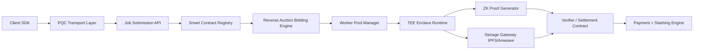
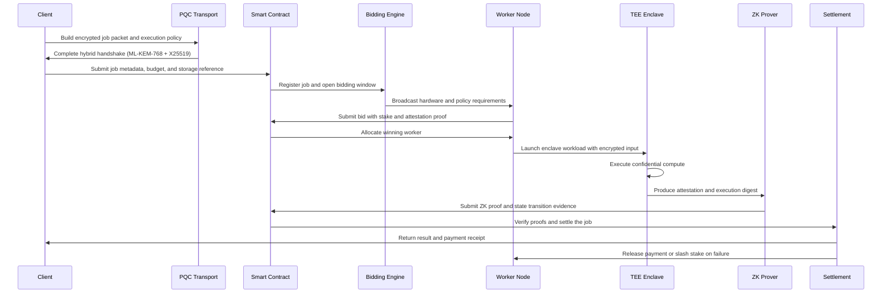

# Post-Quantum, Zero-Trust, Decentralized Compute Architecture

This repository contains the reference implementation and MVP for a decentralized compute platform designed for zero-trust environments. It combines **post-quantum cryptography (PQC)**, **confidential execution**, **verifiable computation**, and **decentralized orchestration** to preserve confidentiality, integrity, and economic security without a centralized operator.

---

## 🚀 Getting Started (Phase 1 MVP)

### Prerequisites
- [Node.js & npm](https://nodejs.org/) (for smart contracts)
- [Rust & Cargo](https://rustup.rs/) (for cryptographic modules)
- [Python 3.12+](https://www.python.org/) (for the Client SDK)

### 1. Smart Contracts
The decentralized orchestration layer is built with Solidity and Hardhat.

```bash
cd contracts
npm install
npx hardhat test      # Run unit tests
npx hardhat compile   # Compile the contracts
```

### 2. Cryptographic Layer (PQC)
The core cryptographic handshake uses a hybrid post-quantum approach.

```bash
cd crypto/pqc
cargo build
cargo test
```

### 3. Client SDK
The Python client SDK provides an interface for interacting with the smart contracts and encrypting payloads.

```bash
cd apps/client-sdk
pip install -r requirements.txt
```

---

## 📁 Repository Structure

The codebase is organized into domain-specific modules:

```text
.
├── apps/
│   ├── client-sdk/       # Python SDK for job submission and payload encryption
│   └── worker-runtime/   # (Planned) Compute node execution logic
├── contracts/            # Hardhat project for Solidity smart contracts
│   ├── contracts/        # JobOrchestrator.sol
│   └── test/             # Smart contract unit tests
└── crypto/
    └── pqc/              # Rust library for Hybrid ML-KEM-768 + X25519 Handshake
```

---

## 🏗️ System Architecture Blueprint

### Core Objectives
1. **Secure client-to-worker transport** using hybrid PQC + classical key exchange.
2. **Protect stored payloads** with authenticated encryption and provenance signing.
3. **Execute sensitive workloads** inside confidential enclaves with remote attestation.
4. **Verify deterministic state transitions** with ZK proofs and cryptographic commitments.
5. **Use decentralized scheduling** with economic penalties for downtime, slashing, and misconduct.

### Architecture Flow



### End-to-End Job Lifecycle



---

## 🔒 Cryptographic and Security Design

### In-Transit Security
- **ML-KEM-768 (FIPS 203)** for post-quantum key encapsulation.
- Combined with **X25519 ECDH** in a hybrid handshake for compatibility and performance.
- Session derivation via **HKDF-SHA-256**.
- Payloads protected with **AES-256-GCM** after session keys are established.

### At-Rest Security
- Encrypt payload blocks with **AES-256-GCM**.
- Sign encrypted data and metadata with **ML-DSA (FIPS 204)** for provenance and tamper evidence.
- Store content-addressed references on IPFS or Arweave.

### In-Use Security & Verifiable Compute
- **TEE Enclaves**: Use AMD SEV-SNP or Intel SGX/TDX. Enclave attestation is verified before decrypting inputs or releasing results.
- **ZK Proofs**: A dual verification strategy where ZK proofs verify deterministic logic/state transitions, while TEE proves trusted execution.

---

## ⚖️ Decentralized Orchestration

### Reverse-Auction Bidding Engine
Jobs are matched to workers using a weighted function:
`score = w1(capability) + w2(reputation) + w3(stake) - w4(latency)`

### Economic Security and Governance
- **Collateral**: Nodes must bond collateral before participating in job execution.
- **Slashing**: Conditions include worker downtime, invalid proof submissions, unauthorized enclave execution, and repeated failures.

---

## 🛡️ Threat Model

| Threat Vector | Mitigation |
|---|---|
| **Harvest-now-decrypt-later** | Adopt ML-KEM-768 and ML-DSA, use hybrid handshake material. |
| **Sybil attacks on worker pools** | Require stake, reputation scoring, attestation, and identity binding. |
| **Enclave side-channel leakage** | Constant-time code, restrict sensitive paths, rely on hardware protections. |
| **Reverse-auction collusion** | Reputation-weighted scoring, randomized tie-breaking, anti-collusion checks. |
| **Malicious proof submission** | Dual verification with TEE evidence and ZK proof checks. |
| **Storage tampering** | Signed manifests, content-addressed CIDs, and hash commitments. |

---

## 🚀 Future Phases

- **Phase 2 (Confidential Compute Expansion):** Integration of enclave-backed execution for privacy-sensitive analytics and multi-worker failover.
- **Phase 3 (Advanced Governance & FHE):** Fully Homomorphic Encryption (CKKS/BFV) support for privacy-preserving analytics, and advanced stake delegation mechanics/cross-chain settlement.

---

## 💻 End-to-End Local Execution Guide (Current State)

You can run the entire lifecycle locally. This will simulate a Client submitting an encrypted Python job to the Smart Contract, uploading it to IPFS, and a Worker node picking it up, decrypting it, executing it in a sandbox, and submitting a ZK-proof hash to reclaim its stake.

### ⚡ Automated Execution (Recommended for Windows)

To avoid managing multiple terminal windows and Python environments manually, you can simply run the provided batch script:

1. Double-click the `start_demo.bat` file in the root directory (or run `.\start_demo.bat` from PowerShell).
2. The script will automatically open 5 separate terminal windows.
3. It activates the `.venv` virtual environment in each window.
4. It starts the Blockchain, Mock IPFS Server, Worker Node, and Client SDK in the correct order.
5. Watch the "Worker Node" and "Client SDK" terminals to see the process execute.

### 🛠️ Manual Execution (For Linux/Mac or Troubleshooting)

If you prefer to run it manually, follow these steps across multiple terminal windows:
### Terminal 1: Start Local Blockchain
```bash
cd contracts
npx hardhat node
```

### Terminal 2: Deploy Smart Contract
Leave Terminal 1 running and open a new terminal:
```bash
cd contracts
npx hardhat run scripts/deploy.ts --network localhost
```
*Make sure the deployed address matches the one hardcoded in `apps/client-sdk/client.py` and `apps/worker-runtime/worker.py` (currently `0x5FbDB2315678afecb367f032d93F642f64180aa3`).*

### Terminal 3: Start Mock IPFS Server
Open a new terminal. Make sure your Python virtual environment is activated:
```bash
# Activate virtual environment first
# Windows: .venv\Scripts\activate
# Linux/Mac: source .venv/bin/activate

python apps/mock_ipfs.py
```

### Terminal 4: Start the Worker Node
Open a new terminal. Activate the virtual environment:
```bash
cd apps/worker-runtime
python worker.py
```
*The worker will initialize, connect to the blockchain, and listen for `JobRegistered` events.*

### Terminal 5: Submit a Job as the Client
Open a new terminal. Activate the virtual environment:
```bash
cd apps/client-sdk
python client.py
```

### What you will see:
1. The **Client** will generate a PQC session key, write it to `shared_key.bin` (our temporary bridge), encrypt a Python script, upload it to the mock IPFS, and register the job on the blockchain.
2. The **Worker** will see the job, submit a bid with a 1 ETH stake, and win the job.
3. The **Worker** will download the encrypted payload, verify its ML-DSA signature, decrypt it, and execute it securely in a subprocess sandbox.
4. The **Worker** will hash the stdout (`Computed confidential sum: 666616.4591971084`) and submit that hash to the smart contract as an execution proof.
5. The **Worker** automatically reclaims its 1 ETH stake upon success!
