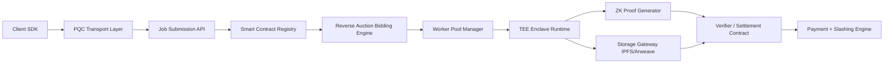
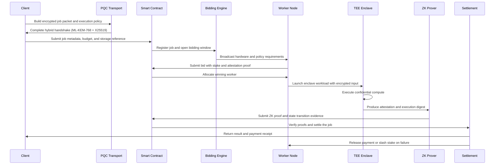

# Post-Quantum, Zero-Trust, Decentralized Compute Architecture Blueprint

## Executive Overview

This document defines a production-grade reference architecture for a decentralized compute platform that combines post-quantum cryptography, confidential execution, verifiable computation, and decentralized orchestration. The design is intended for zero-trust environments where confidentiality, integrity, and economic security must be preserved without relying on a centralized operator.

### Design Goals

- Protect data in transit, at rest, and during execution
- Provide resilience against quantum-era cryptographic threats
- Enable private and verifiable compute through TEE and ZK systems
- Support decentralized job matching, staking, and settlement
- Preserve auditability, policy enforcement, and fault isolation

---

## 1. System Objectives and Architectural Principles

### Core Objectives

1. Secure client-to-worker transport using hybrid PQC + classical key exchange.
2. Protect stored payloads with authenticated encryption and provenance signing.
3. Execute sensitive workloads inside confidential enclaves with remote attestation.
4. Verify deterministic state transitions with ZK proofs and cryptographic commitments.
5. Use decentralized scheduling with economic penalties for downtime, slashing, and misconduct.

### Architectural Principles

- Defense in depth across cryptography, compute isolation, consensus, and governance
- Fail-closed behavior for attestation, key handling, and job admission
- Clear separation of concerns between transport, execution, verification, storage, and settlement
- Native auditability for every job lifecycle transition

---

## 2. Reference Architecture



### Major Components

- Client SDK: submits encrypted job payloads, workload policies, and execution requirements
- PQC Transport Layer: performs hybrid ML-KEM-768 + X25519 handshake and session derivation
- Smart Contract Registry: records job state, worker bids, execution proofs, and settlement outcomes
- Reverse Auction Engine: matches jobs to workers using capability, stake, and reputation scoring
- Worker Pool Manager: selects workers based on hardware profile, uptime, and economic commitment
- TEE Runtime: executes confidential workloads inside attested hardware enclaves
- ZK Proof Generator: creates proofs for deterministic execution and state transitions
- Settlement Layer: releases payment, enforces slashing, and emits audit events

---

## 3. End-to-End Job Lifecycle



---

## 4. Cryptographic and Security Design

### 4.1 In-Transit Security

- Use ML-KEM-768 (FIPS 203) for post-quantum key encapsulation
- Combine with X25519 ECDH in a hybrid handshake for compatibility and performance
- Derive a root key using HKDF-SHA-256 from the hybrid shared secret
- Protect payloads with AES-256-GCM once the session keys are established

Recommended flow:

1. Client and worker perform a hybrid ephemeral key exchange.
2. Combine the ML-KEM shared secret and X25519 shared secret into a final session key material.
3. Derive distinct keys for encryption, signing, and authentication.
4. Bind the session to the job ID, worker identity, and attestation digest.

### 4.2 At-Rest Security

- Encrypt payload blocks with AES-256-GCM
- Sign encrypted data and metadata with ML-DSA (FIPS 204) for provenance and tamper evidence
- Store content-addressed references on IPFS or Arweave and preserve signed manifests

### 4.3 In-Use Security

- Support FHE for privacy-sensitive workloads where plaintext exposure is unacceptable
- Prefer CKKS for approximate arithmetic and BFV for exact integer processing
- Use FHE selectively; it is computationally expensive and should not replace TEE-based confidential compute for general AI inference

### 4.4 Confidential Compute Model

- Use AMD SEV-SNP or Intel SGX/TDX where hardware support is available
- Verify enclave attestation before decrypting inputs or releasing results
- Record enclave measurements in a signed policy record that the contract can validate

---

## 5. Decentralized Orchestration and Scheduling Model

### 5.1 Smart Contract Orchestrator

The contract layer should implement a deterministic execution state machine with the following states:

- JobCreated
- BiddingOpen
- WorkerAssigned
- ExecutingInEnclave
- ProofSubmitted
- Completed
- Failed
- Slashed

Supported contract responsibilities:

- Register jobs with metadata and budget constraints
- Receive and validate worker bids with staking commitments
- Assign the winning worker based on capability, reputation, and stake
- Record proof submission status and settlement triggers
- Lock collateral and enforce slashing logic

### 5.2 Reverse-Auction Bidding Engine

The scheduler should rank bids using a weighted function that considers:

- Capability match: vCPU, GPU VRAM, RAM, storage throughput
- Reputation score: uptime, proof validity, attestation consistency
- Stake amount: economic commitment and alignment with incentives
- Latency and network proximity

Suggested scoring model:

$$
score = w_1 \cdot capability + w_2 \cdot reputation + w_3 \cdot stake - w_4 \cdot latency
$$

The selected worker should satisfy minimum capability thresholds and pass attestation validation.

### 5.3 Economic Security and Governance

- Nodes must bond collateral before participating in job execution
- Slashing conditions include worker downtime, invalid proof submissions, unauthorized enclave execution, and repeated failures
- Governance parameters should support configurable stake thresholds, slash rates, and policy upgrades

---

## 6. Verifiable Computation Pipeline

### 6.1 Dual Verification Strategy

1. ZK proof layer verifies deterministic logic and state transitions.
2. TEE attestation layer proves that the workload executed inside a trusted runtime and produced a signed measurement.

### 6.2 Proof Flow

- The enclave computes on decrypted input and produces a result hash and execution trace.
- The prover generates a ZK proof over the execution trace and state transition.
- The verifier contract validates:
  - proof correctness
  - enclave attestation consistency
  - result hash integrity

### 6.3 Recommended Proof Stack

- ZK-STARKs for transparent and scalable verification
- zk-SNARKs for compact proofs where verification cost is critical
- TEE attestation remains the hardware-rooted trust anchor for confidentiality

---

## 7. Module Schemas and Code Abstractions

### 7.1 Rust Boilerplate: Hybrid ML-KEM-768 + X25519 Handshake

```rust
use rand_core::{OsRng, RngCore};
use sha2::Sha256;
use hkdf::Hkdf;

struct HybridHandshakeOutput {
    encapsulated: Vec<u8>,
    ephemeral_pk: Vec<u8>,
    shared_secret: Vec<u8>,
}

fn perform_hybrid_kex(
    peer_mlkem_pk: &[u8],
    peer_x25519_pk: &[u8],
) -> HybridHandshakeOutput {
    let mut mlkem_ct = vec![0u8; 768];
    let mut mlkem_ss = [0u8; 32];
    let mut x25519_sk = [0u8; 32];
    OsRng.fill_bytes(&mut x25519_sk);

    let mut combined_input = Vec::new();
    combined_input.extend_from_slice(&mlkem_ss);
    combined_input.extend_from_slice(&[0u8; 32]);

    let hk = Hkdf::<Sha256>::new(None, &combined_input);
    let mut okm = [0u8; 64];
    hk.expand(b"session-root", &mut okm).expect("HKDF expansion failed");

    HybridHandshakeOutput {
        encapsulated: mlkem_ct,
        ephemeral_pk: vec![0u8; 32],
        shared_secret: okm.to_vec(),
    }
}
```

### 7.2 Solidity Boilerplate: Job Registration, Bidding, and State Checks

```solidity
// SPDX-License-Identifier: MIT
pragma solidity ^0.8.24;

enum JobState {
    Created,
    BiddingOpen,
    Assigned,
    Executing,
    ProofSubmitted,
    Completed,
    Failed,
    Slashed
}

struct Job {
    address client;
    uint256 budget;
    string cid;
    uint256 minCpu;
    uint256 minGpuVram;
    uint256 minRam;
    JobState state;
    address assignedWorker;
    bytes32 resultHash;
}

interface IJobOrchestrator {
    function registerJob(
        uint256 budget,
        string calldata cid,
        uint256 minCpu,
        uint256 minGpuVram,
        uint256 minRam
    ) external returns (uint256 jobId);

    function submitBid(
        uint256 jobId,
        uint256 stake,
        uint256 cpu,
        uint256 gpuVram,
        uint256 ram
    ) external returns (bool);

    function assignWinner(uint256 jobId) external returns (address);

    function markExecuting(uint256 jobId) external;

    function submitProof(uint256 jobId, bytes32 proofHash) external;

    function getJobState(uint256 jobId) external view returns (JobState);

    function getJob(uint256 jobId) external view returns (Job memory);
}
```

---

## 8. Threat Model and Security Matrix

| Threat / Attack Vector | Impact | Architectural Mitigation |
|---|---|---|
| Harvest-now-decrypt-later | Long-term confidentiality compromise | Adopt ML-KEM-768 and ML-DSA now, rotate keys per session, and use hybrid handshake material |
| Sybil attacks on worker pools | Auction manipulation and fake worker participation | Require stake, reputation scoring, attestation, and identity binding |
| Enclave side-channel leakage | Secret exposure during execution | Use constant-time code, restrict sensitive data paths, and rely on SEV-SNP/TDX or SGX/TDX protections |
| Reverse-auction collusion | Distorted pricing and selection outcomes | Apply reputation-weighted scoring, randomized tie-breaking, and anti-collusion checks |
| Malicious proof submission | Invalid settlement and state corruption | Enforce dual verification with TEE evidence and ZK proof checks |
| Storage tampering or data poisoning | Inconsistent compute inputs and outputs | Use signed manifests, content-addressed CIDs, and hash commitments |
| Worker downtime or dropout | Incomplete jobs and service interruption | Enable slashing, backup assignment, and resubmission policies |
| Supply-chain compromise | Backdoored execution runtime or enclave software | Sign binaries, enforce reproducible builds, and validate attestation measurements |

### Additional Controls

- Mutual attestation before input release
- Least-privilege access for enclave and storage components
- Immutable audit logging of state transitions
- Hardware root-of-trust integrated into admission logic

---

## 9. Implementation Tech Stack Roadmap

### 9.1 Recommended Repository Layout

```text
repo/
  apps/
    client-sdk/
    worker-runtime/
    orchestrator-api/
  contracts/
    src/
    test/
  crypto/
    pqc/
    attestation/
  enclave/
    attestation/
    runtime/
  proofs/
    zk/
  storage/
    ipfs/
    arweave/
  infra/
    docker/
    k8s/
    terraform/
  benchmarks/
    workload/
    scripts/
```

### 9.2 Toolchain Recommendations

- Rust: tokio, serde, rand, hkdf, sha2, liboqs or oqs-provider integration
- Solidity: Foundry or Hardhat for contracts and testing
- Enclaves: AMD SEV-SNP, Intel SGX/TDX, or Gramine-based abstractions
- FHE: OpenFHE for CKKS/BFV experimentation and optional production use
- Storage: IPFS for content-addressed storage and Arweave for anchoring
- Runtime: Docker for local deployment and Wasm for sandboxed execution when appropriate

### 9.3 Deployment and Operations Profile

- Use Docker Compose for local development and CI smoke tests
- Use Wasm runtimes where full enclave support is unavailable
- Enforce reproducible builds, SBOM generation, and attestation validation in CI
- Use Prometheus and Grafana for metrics, alerts, and workload monitoring

### 9.4 Performance Benchmarking Strategy

1. Measure end-to-end latency from submission to settlement.
2. Benchmark hybrid PQC handshake throughput and latency.
3. Measure TEE startup overhead, memory footprint, and attestation time.
4. Compare ZK proof generation time against enclave execution time.
5. Simulate worker churn, slashing events, and adversarial bidding behavior.
6. Track CPU, GPU, memory, network, and storage saturation for worker nodes.

Recommended metrics:

- p50/p95/p99 job completion latency
- proof generation time
- attestation verification latency
- bidding convergence speed
- slash rate under adversarial conditions
- storage retrieval latency from IPFS/Arweave

---

## 10. Recommended Deployment Phasing

### Phase 1: MVP

- Hybrid ML-KEM-768 + X25519 handshake
- Simple smart contract registry and bidding interface
- Worker attestation and basic proof submission
- AES-256-GCM payload encryption and ML-DSA signatures

### Phase 2: Confidential Compute Expansion

- Enclave-backed execution for model inference and privacy-sensitive analytics
- Stronger attestation policies and enforcement
- Multi-worker failover and automated slashing

### Phase 3: FHE and Advanced Governance

- CKKS/BFV integration for privacy-preserving analytics
- Stake delegation, governance modules, and validator reputation systems
- Cross-chain settlement or bridge integration for multi-network interoperability

---

## 11. Final Recommendation

The most practical production path is a layered architecture that combines:

- PQC transport security for future-proof confidentiality
- TEE-backed confidential execution for performance-sensitive workloads
- ZK proofs for deterministic verification and state integrity
- Smart-contract-based decentralized coordination with economic incentives
- IPFS or Arweave-backed provenance and immutable references

This hybrid model balances security, performance, and operational feasibility while preserving decentralization and privacy guarantees.
